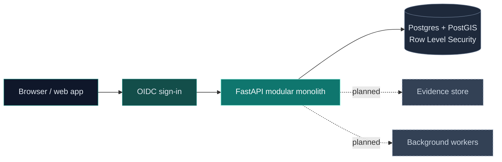

<div align="center">

<!-- brand accent — deep teal / slate, not purple -->


# OYDP

### Own Your Dream Property

**India-first continuous property lifecycle** — a permissioned workspace where people, evidence, and spatial context stay together across the life of a property.

[](#where-we-actually-are)
[](#the-13-engines)
[](#how-it-fits-together)
[](#api-increments)
[](#latest-verified-backend-build)

<br/>

<sub>
Honest pre-alpha. Not a registry. Not a government portal. Not production-ready.
</sub>

</div>

---

## Why OYDP exists

Indian property work is fragmented. Title papers live in one drawer, survey sketches in another, WhatsApp threads elsewhere, and every “official” claim needs careful verification. People lose the thread between discovery, claim, diligence, and long-term ownership.

OYDP’s bet is simple: give serious participants a **permissioned workspace** where lifecycle state and **evidence** can travel together — without pretending we are the government, and without inventing data we do not have.

We are building that foundation carefully. Pre-alpha means the skeleton is real; the product is not finished.

---

## What we do **not** claim

Please read this before anything else.

| We do **not** | Meaning |
| --- | --- |
| Issue unverified ownership certificates | OYDP is not proof of title |
| Invent or scrape “official” data | No fabricated registry / survey / mutation records |
| Guarantee valuations | Any value models are advisory research, never a promise |
| Speak for government systems | No claimed API access to state or central land portals |
| Ship production / gov-verified software | This repo is pre-alpha engineering |

If a feature would require us to fake certainty, we leave it unbuilt.

---

## The 13 engines

Thirteen engines are **planned release commitments**. None are production-complete. Names below match the controlling blueprint and [`docs/ENGINE_REGISTER.md`](docs/ENGINE_REGISTER.md). Status language there is authoritative; this table is orientation only.

| ID | Engine | Notes |
| :---: | --- | --- |
| **E01** | Property Identity & Evidence Graph | Partial pre-alpha slice on `apps/api` |
| **E02** | AI Property Advisor | Planned |
| **E03** | Transaction & Legal Workspace | Bounded diligence requests only; rest planned |
| **E04** | Living Property Passport | Planned |
| **E05** | Ownership Action Engine | Planned |
| **E06** | OYDP Real Estate Academy | Planned |
| **E07** | SpatialLedger GIS Intelligence | Planned |
| **E08** | Property Valuation & Market Intelligence | Planned |
| **E09** | AI Layout & Architecture Concept Studio | Planned |
| **E10** | Development & Business Feasibility | Planned |
| **E11** | Marketplace & Professional Network | Planned |
| **E12** | Time-Versioned Spatial Digital Twin | Planned |
| **E13** | Institutional API & Evidence Attestations | Planned |

<div align="center">


</div>

---

## How it fits together

Modular monolith: one deployable backend today, clear module boundaries so engines can grow without a microservice zoo.



ASCII sketch if Mermaid is collapsed:

```
Browser ──► OIDC ──► FastAPI (modular monolith)
                         │
                         ▼
              Postgres / PostGIS + RLS
                         │
            ┌────────────┴────────────┐
            ▼                         ▼
     evidence store              workers
        (planned)               (planned)
```

---

## Where we actually are

Honest status — green means “exists and is useful in-repo,” amber means “partial / scaffolding,” slate means “planned.”

| Surface | Status | Notes |
| --- | :---: | --- |
| FastAPI backend foundation |  | Pre-alpha; see build note below |
| Postgres + PostGIS + RLS |  | Spatial + tenancy primitives in progress |
| Web client |  | Not a finished product UI |
| OIDC auth path |  | Foundation for permissioned access |
| Evidence store / workers |  | On the architecture diagram for a reason |
| Engines E01–E13 |  | Release commitments, not shipped modules |
| Government data feeds |  | We do not invent or assert access |

### Dual-backend reconciliation

> **Authority.** Evolve only `apps/api` + `infra/db` (public schema, role `oydp_app`). Root `oydp/` + `migrations/` is a **frozen PR #1 reference** (schema `oydp`, role `oydp_runtime`): separately CI-tested, not mounted, not interchangeable. See [`docs/implementation/PR1_RECONCILIATION.md`](docs/implementation/PR1_RECONCILIATION.md) and `AGENTS.md`.

### API increments

- **API 0.3 — privacy** — privacy-respecting defaults for workspace data; foundation for grants.
- **API 0.4 — discovery / claims** — early discovery and claims surfaces on top of that privacy base.

These are incremental pre-alpha slices, not versioned public product APIs with SLAs.

### Merged workspace migrations `008`–`014`

Workspace migrations **008 through 014** are merged into the shared migration line. Apply them in order on a fresh foundation database. Do not cherry-pick mid-stream; if you fork schema locally, rebase onto the merged sequence before opening a PR.

---

## Repo layout

```
OYDP/
├── apps/
│   ├── api/          # Canonical FastAPI surface (active)
│   └── web/          # Authenticated Next.js workspace (pre-alpha)
├── infra/db/         # Canonical checksum migrations (public schema)
├── oydp/             # Frozen PR #1 reference package (not mounted)
├── migrations/       # Reference oydp-schema migrations only
├── docs/             # Design, boundaries, engineering notes
├── AGENTS.md         # Agent & contributor gates — read before automated edits
├── SECURITY.md       # Vulnerability disclosure
└── README.md         # You are here
```

Exact folder names may evolve as the dual-backend reconciliation lands; when docs and tree disagree, trust `AGENTS.md` and the latest engineering note.

---

## Local foundation setup

### POSIX (Linux / macOS)

1. Clone the repo and enter it.
2. Install Python 3.11+, Node (for web), Docker (Postgres/PostGIS recommended).
3. Copy `.env.example` → `.env` and fill OIDC + database URLs for **local** use only.
4. Bring up PostGIS, run migrations through **014**, start the API from the **canonical** backend path (see reconciliation warning).
5. Run the test suite before you trust your checkout.

```bash
# illustrative — follow docs/ and AGENTS.md for the canonical commands
cp .env.example .env
docker compose up -d db          # PostGIS
# run migrations  →  start API  →  optional web
```

### Windows notes

- Prefer **WSL2** for parity with POSIX scripts and Docker Desktop’s Linux engine.
- Native PowerShell works for editing; treat shell scripts as WSL-first unless a `*.ps1` helper exists.
- Path length and CRLF: keep `core.autocrlf` sane and avoid binding PostGIS data dirs to non-WSL paths when possible.

We do not document a production deploy here — because we are not production.

---

## Engineering workflow & release boundaries

- Read **[`AGENTS.md`](AGENTS.md)** before agent-driven or bulk edits — security and contribution gates stay intact.
- Keep PRs small; say which engine or API increment you are touching.
- **Release geography (near-term):** Bengaluru → Karnataka → Hyderabad. Do not assume pan-India coverage, data, or compliance.
- No silent “official data” integrations. If a PR needs an external registry feed, it needs an explicit design note and honest sourcing.

---

## Roadmap

| Horizon | Focus |
| --- | --- |
| **Now** | Keep `apps/api` + `infra/db` as sole evolving authority; harden OIDC/dev gates, RLS, and Property Workspace evidence/document paths |
| **Next** | Real malware scanner adapter; production identity enrollment; MFA freshness; independent audit sink; deepen remaining engines without claiming completion |
| **Later** | Broader engine delivery (E02–E13 beyond current slices); workers; carefully scoped regional expansion past Bengaluru / Karnataka / Hyderabad — still without fake gov certainty |

---

## Security

Found a vulnerability? Please use **[`SECURITY.md`](SECURITY.md)** — do not open a public issue with exploit detail.

We are pre-alpha. That is not an excuse for sloppy auth, leaked secrets, or disabled RLS in shared environments. It *is* a reason to avoid marketing language like “SOC 2 certified” until those programs actually exist.

---

## Ownership & licensing

Ownership and licensing are **not finalized**. Do not assume OSI open source, commercial rights, or contribution terms beyond what is written in-repo today. If you need clarity for a partnership or fork, ask the founder before shipping derivatives.

---

## Latest verified backend build

<div align="center">


</div>

This is **pre-alpha evidence only** — a checkpoint that the backend foundation held under its then-current suite. It is not a release, not a compliance attestation, and not a claim that engines or the web app are done.

---

## Docs & gates worth keeping open

| Doc | Why |
| --- | --- |
| [`SECURITY.md`](SECURITY.md) | Disclosure path |
| [`AGENTS.md`](AGENTS.md) | Automation / contributor gates |
| `docs/` | Boundaries, design, regional notes |

---

<div align="center">

**OYDP** — Own Your Dream Property

<sub>Built carefully in Bengaluru. India-first. Evidence over theatre.</sub>

</div>
