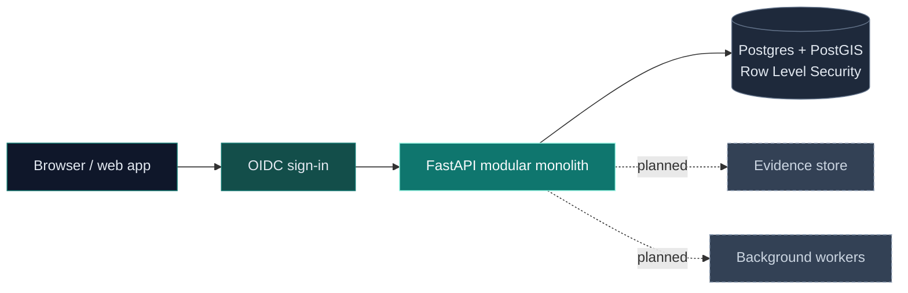

<div align="center">

<!-- brand accent — deep teal / slate, not purple -->


# OYDP

### Own Your Dream Property

**India-first continuous property lifecycle** — a permissioned workspace where people, evidence, and spatial context stay together across the life of a property.

[](#where-we-actually-are)
[](#the-13-engines)
[](#how-it-fits-together)
[](#what-this-checkout-does)

<br/>

<sub>
Honest pre-alpha. Not a registry. Not a government portal. Not production-ready.
</sub>

</div>

---

## Why OYDP exists

Indian property work is fragmented. Title papers live in one drawer, survey sketches in another, WhatsApp threads elsewhere, and every “official” claim needs careful verification. People lose the thread between discovery, claim, diligence, and long-term ownership.

OYDP’s bet is simple: give serious participants a **permissioned workspace** where lifecycle state and **evidence** can travel together — without pretending we are the government, and without inventing data we do not have.

We are building that foundation carefully. Pre-alpha means the skeleton is real; the product is not finished.

---

## What we do **not** claim

Please read this before anything else.

| We do **not** | Meaning |
| --- | --- |
| Issue unverified ownership certificates | OYDP is not proof of title |
| Invent or scrape “official” data | No fabricated registry / survey / mutation records |
| Guarantee valuations | Any value models are advisory research, never a promise |
| Speak for government systems | No claimed API access to state or central land portals |
| Ship production / gov-verified software | This repo is pre-alpha engineering |

If a feature would require us to fake certainty, we leave it unbuilt.

---

## The 13 engines

Thirteen engines are **planned release commitments**. None are production-complete. Names below match the controlling blueprint and [`docs/ENGINE_REGISTER.md`](docs/ENGINE_REGISTER.md). Status language there is authoritative; this table is orientation only.

| ID | Engine | Notes |
| :---: | --- | --- |
| **E01** | Property Identity & Evidence Graph | Partial. Private properties, unverified claims, grants, corrections, delegated write, quarantined documents, identifiers, sources, reviews, consent-gated export, read-only evidence graph, and unresolved conflict signals. Not title, and not a complete evidence graph |
| **E02** | AI Property Advisor | Planned. Not built |
| **E03** | Transaction & Legal Workspace | Bounded diligence requests and notes only. Not offers, payments, or legal conclusions |
| **E04** | Living Property Passport | Planned |
| **E05** | Ownership Action Engine | Planned |
| **E06** | OYDP Real Estate Academy | Planned |
| **E07** | SpatialLedger GIS Intelligence | Planned |
| **E08** | Property Valuation & Market Intelligence | Planned |
| **E09** | AI Layout & Architecture Concept Studio | Planned |
| **E10** | Development & Business Feasibility | Planned |
| **E11** | Marketplace & Professional Network | Planned |
| **E12** | Time-Versioned Spatial Digital Twin | Planned |
| **E13** | Institutional API & Evidence Attestations | Planned |

<div align="center">


</div>

---

## How it fits together

Modular monolith: one deployable backend today, clear module boundaries so engines can grow without a microservice zoo.



ASCII sketch if Mermaid is collapsed:

```
Browser ──► OIDC ──► FastAPI (modular monolith)
                         │
                         ▼
              Postgres / PostGIS + RLS
                         │
            ┌────────────┴────────────┐
            ▼                         ▼
     evidence store              workers
        (planned)               (planned)
```

---

## Where we actually are

Honest status. Amber means a bounded slice exists in this repo and is not production-complete. Slate means not built.

| Surface | Status | Notes |
| --- | :---: | --- |
| FastAPI `apps/api` |  | Property Identity API **0.18.0** |
| Postgres + PostGIS + RLS |  | `infra/db` migrations `001`–`021`, role `oydp_app`, forced row security |
| Next.js `apps/web` |  | Authenticated workspace with evidence graph / conflict reads. Not a finished product UI |
| OIDC and MFA freshness |  | High-risk routes require a fresh MFA `auth_time`. Loopback HTTP is an explicit dev flag |
| Separate evidence platform / workers |  | Document bytes stay encrypted in Postgres |
| Engines E02–E13 |  | Launch commitments. Only E03 diligence requests exist, and only in a bounded form |
| Government data feeds |  | No state or central land-portal integration |

### What this checkout does

The active services are `apps/api` and the Next.js workspace in `apps/web`. `apps/api/app/main.py` sets the API version to **0.18.0**. Root `oydp/` is not that service.

For a property the caller is allowed to see, the API can:

- Keep the property private to its creator or to an unexpired, unrevoked read grant
- Record claims as unverified user claims, optionally citing a live source
- Correct the label and jurisdiction, and keep the correction history
- Delegate write to another member of the same tenant for a limited time
- Store an upload as an encrypted quarantined document with optional claim/source/identifier attribution. The request cannot mark the file clean. No malware scanner is bundled, so a clean download stays closed
- Record versioned identifiers
- Register a source while rights status stays unknown
- Store a professional review that does not change title, with optional source/claim/document/identifier citations
- Project a read-only evidence graph and unresolved conflict signals (not adjudicated; never title)
- Export an evidence packet only after the database records live creator consent. The packet’s `title_verified` field is false; cited sources are included when present
- Append audit events to an audit ledger. The application role cannot rewrite it. This is not an external write-once archive, and a database superuser can still disable triggers
- Let a tenant owner revoke another member or invalidate that member's application sessions. Revoke deletes the membership and cascaded grants. Tokens issued before the recorded not-before time are rejected. This does not revoke the token at a live identity provider

Local sign-in is a development path. The API accepts an `http://127.0.0.1` or `http://localhost` issuer and JWKS URL only when `OYDP_OIDC_DEV_HTTP=1`. The disposable issuer in `tools/dev_oidc.py` binds loopback and refuses to start unless `OYDP_DEV_OIDC=1`. High-risk routes require `mfa` or `otp` in `amr` and a fresh integer `auth_time` (default maximum age 900 seconds). Setting that age to `0` is refused unless the loopback dev flag is on. Live Keycloak enrollment is not verified in this repository.

This build does not verify title, speak for a government office, or guarantee a value.

How the slices are implemented, and which limits remain, is written under [`docs/`](docs/README.md). Useful entry points are `docs/implementation/BUILD_STATUS.md`, `IDENTITY_GATE.md`, `VERIFICATION_REGISTER.md`, `WEB_CSP.md`, and [`docs/ENGINE_REGISTER.md`](docs/ENGINE_REGISTER.md). Those notes are not production approval and not an independent audit.

### Dual-backend reconciliation

> **Authority.** Evolve only `apps/api` + `infra/db` (public schema, role `oydp_app`). Root `oydp/` + `migrations/` is a **frozen PR #1 reference** (schema `oydp`, role `oydp_runtime`): separately CI-tested, not mounted, not interchangeable. See [`docs/implementation/PR1_RECONCILIATION.md`](docs/implementation/PR1_RECONCILIATION.md) and `AGENTS.md`.

### API version

The running Property Identity API reports **0.18.0**. Earlier privacy, discovery, trusted-evidence, diligence, attribution, graph, and conflict work sits inside that service. It is not a versioned public product with an SLA.

### Canonical migrations `001`–`021`

Apply `infra/db` migrations **001 through 021** in order on a fresh foundation database. Do not cherry-pick mid-stream; if you fork schema locally, rebase onto the merged sequence before opening a PR.

---

## Repo layout

```
OYDP/
├── apps/
│   ├── api/          # Canonical FastAPI surface (active, 0.18.0)
│   └── web/          # Authenticated Next.js workspace (pre-alpha)
├── infra/db/         # Canonical checksum migrations 001–021 (public schema)
├── oydp/             # Frozen PR #1 reference package (not mounted)
├── migrations/       # Reference oydp-schema migrations only
├── docs/             # Design, boundaries, engineering notes (see docs/README.md)
├── .github/          # CI workflows + pull request template
├── AGENTS.md         # Agent & contributor gates — read before automated edits
├── SECURITY.md       # Vulnerability disclosure
└── README.md         # You are here
```

When a doc and the tree disagree, trust `AGENTS.md` and the code. `apps/api` with `infra/db` is the evolving service. Root `oydp/` stays the frozen reference.

---

## Local foundation setup

### POSIX (Linux / macOS)

1. Clone the repo and enter it.
2. Install Python 3.11+, Node (for web), Docker (Postgres/PostGIS recommended).
3. Copy `.env.example` → `.env` and fill OIDC + database URLs for **local** use only.
4. Bring up PostGIS, run migrations through **020**, start the API from the **canonical** backend path (see reconciliation warning).
5. Run the test suite before you trust your checkout.

```bash
# illustrative — follow docs/ and AGENTS.md for the canonical commands
cp .env.example .env
docker compose up -d db          # PostGIS
# run migrations  →  start API  →  optional web
```

### Windows notes

- Prefer **WSL2** for parity with POSIX scripts and Docker Desktop’s Linux engine.
- Native PowerShell works for editing; treat shell scripts as WSL-first unless a `*.ps1` helper exists.
- Path length and CRLF: keep `core.autocrlf` sane and avoid binding PostGIS data dirs to non-WSL paths when possible.

We do not document a production deploy here — because we are not production.

---

## Engineering workflow & release boundaries

- Read **[`AGENTS.md`](AGENTS.md)** before agent-driven or bulk edits — security and contribution gates stay intact.
- Keep PRs small; say which engine or API increment you are touching.
- **Release geography (near-term):** Bengaluru → Karnataka → Hyderabad. Do not assume pan-India coverage, data, or compliance.
- No silent “official data” integrations. If a PR needs an external registry feed, it needs an explicit design note and honest sourcing.

---

## Roadmap

| Horizon | Focus |
| --- | --- |
| **Now** | `apps/api` 0.18.0 and the `apps/web` workspace on the shared identity, RLS, evidence graph, and conflict paths. MFA freshness, web CSP middleware, and application membership-session checks are enforced in code. Live identity enrollment is not |
| **Next** | A real malware-scanner adapter; production identity enrollment and revocation; an external write-once audit store; the rest of E02–E13 without calling any of them complete |
| **Later** | Broader engine delivery (E02–E13 beyond current slices); workers; carefully scoped regional expansion past Bengaluru / Karnataka / Hyderabad — still without fake gov certainty |

---

## Security

Found a vulnerability? Please use **[`SECURITY.md`](SECURITY.md)** — do not open a public issue with exploit detail.

We are pre-alpha. That is not an excuse for sloppy auth, leaked secrets, or disabled RLS in shared environments. It *is* a reason to avoid marketing language like “SOC 2 certified” until those programs actually exist.

---

## Ownership & licensing

Ownership and licensing are **not finalized**. See [`LICENSE`](LICENSE) (all rights reserved until terms are published). Do not assume OSI open source, commercial rights, or contribution terms beyond what is written in-repo today. If you need clarity for a partnership or fork, ask the founder before shipping derivatives.

---

## Verification

This README does not certify a test count, an audit, or production readiness. Records of what was exercised live in [`docs/implementation/`](docs/implementation/). A green automated run is not an independent review.

---

## Docs & gates worth keeping open

| Doc | Why |
| --- | --- |
| [`SECURITY.md`](SECURITY.md) | Disclosure path |
| [`AGENTS.md`](AGENTS.md) | Automation / contributor gates |
| [`docs/README.md`](docs/README.md) | Documentation map |
| [`docs/implementation/`](docs/implementation/) | What is built, how it is gated, and what is not verified |
| [`docs/ENGINE_REGISTER.md`](docs/ENGINE_REGISTER.md) | Which of the 13 engines exist |

---

<div align="center">

**OYDP** — Own Your Dream Property

<sub>Built carefully in Bengaluru. India-first. Evidence over theatre.</sub>

</div>
